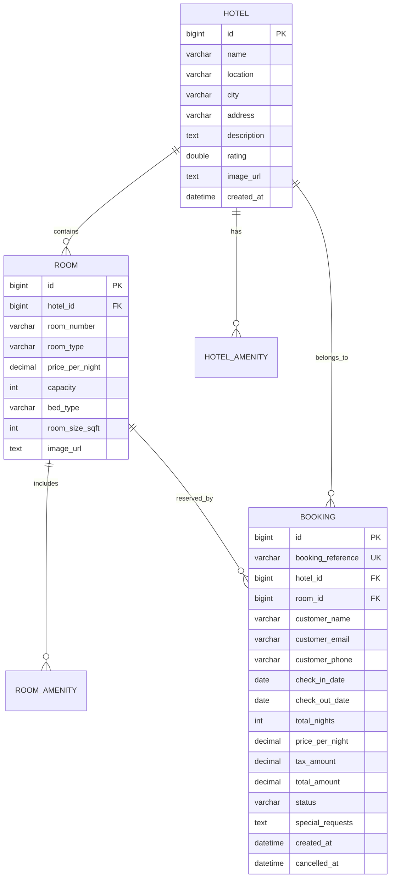

# WANDERO – Technical Architecture & Design Document

## 1. Overview & Brand Goals

**WANDERO** (**Discover places. Find your stay.**) is a modern, production-grade hotel discovery, comparison, and booking platform that makes finding and reserving the perfect stay simple.

The primary engineering goals of the system are:
- **Zero Overbooking Guarantee**: Ensuring that two concurrent guests attempting to reserve the same room for overlapping dates are serialized safely at the database level.
- **Clean Layered Architecture**: Clear separation of concerns across controller, service, repository, entity, and DTO layers.
- **Data Integrity & Real MySQL Persistence**: Avoiding in-memory mocks, utilizing MySQL 8.x schema with foreign key constraints and strategic indexes.
- **Accurate Financial Calculations**: Strict pricing formulas incorporating stay duration, base room tariff, and 12% statutory hospitality tax.
- **Surprise Feature Integration**: A side-by-side Hotel Comparison engine supporting up to 3 properties with total stay calculations and amenities matrix.
- **Premium Travel-Tech Visual Identity**: Typographic text-based logo, curated aesthetics, responsive layout, and seamless user experience across desktop and mobile.

---

## 2. Architecture & Layering Strategy

WANDERO follows the industry-standard **Layered Architectural Pattern**:

```
+-----------------------------------------------------------+
|                  React 18 + Vite (SPA)                    |
|  Pages (Home, MyBookings) | Components | Services (Axios) |
+-----------------------------+-----------------------------+
                              | HTTP / JSON (REST)
+-----------------------------v-----------------------------+
|               Spring Boot 3 Presentation Layer             |
|       HotelController | RoomController | BookingController |
|              @RestControllerAdvice Exception Handler      |
+-----------------------------+-----------------------------+
                              | DTOs
+-----------------------------v-----------------------------+
|                    Business Service Layer                 |
|       HotelService  |  RoomService  |  BookingService     |
|   (Transactional boundaries, Pricing Engine, Concurrency) |
+-----------------------------+-----------------------------+
                              | Domain Entities
+-----------------------------v-----------------------------+
|                   Data Access Layer (JPA)                 |
|       HotelRepository | RoomRepository | BookingRepository|
+-----------------------------+-----------------------------+
                              | JDBC
+-----------------------------v-----------------------------+
|                      MySQL 8.x Database                   |
|         hotels | hotel_amenities | rooms | bookings       |
+-----------------------------------------------------------+
```

### Layer Responsibilities
1. **Controller Layer**: Exposes versioned REST endpoints (`/api/*`), parses request parameters, enforces JSR-380 bean validations (`@Valid`), and maps responses into standardized JSON DTOs.
2. **Service Layer**: Contains core business logic: date range validations, pricing calculations, pessimistic row locking, and booking lifecycle state transitions.
3. **Repository Layer**: Extends Spring Data `JpaRepository` with custom JPQL queries, locking annotations, and indexed lookup queries.
4. **Entity Layer**: Plain Java Persistence entities mapping relational tables with `@Entity`, `@Table`, `@ManyToOne`, `@OneToMany`, and `@ElementCollection`.
5. **DTO Layer**: Decouples external API representations from internal database schema, ensuring internal fields (such as foreign keys and sensitive metadata) are never directly exposed.
6. **Exception Layer**: `@RestControllerAdvice` translates domain exceptions (`RoomNotAvailableException`, `ResourceNotFoundException`, `InvalidBookingException`) into RFC-7807 compliant HTTP responses.

---

## 3. Database Schema & Entity Relationships

The relational model utilizes 4 primary tables with foreign key cascades and indexes tailored for fast range queries:



### Indexing Strategy
- `hotels(city, location)`: Enables high-speed text search and filtering by destination.
- `bookings(booking_reference)`: Unique index ensuring O(1) booking voucher retrieval.
- `bookings(customer_email)`: Facilitates instant retrieval of all bookings for a user.
- `bookings(room_id, check_in_date, check_out_date, status)`: Composite index optimizing overlapping date range queries for availability detection.

---

## 4. Booking Logic & Financial Calculation Engine

### 4.1 Duration Calculation
Stay duration is calculated in whole calendar nights using `java.time.temporal.ChronoUnit.DAYS`:
$$\text{totalNights} = \text{checkOutDate} - \text{checkInDate}$$

Validation requirements:
- $\text{checkInDate} \ge \text{today}$
- $\text{checkOutDate} > \text{checkInDate}$
- $\text{totalNights} \ge 1$

### 4.2 Financial Breakdown
1. **Base Stay Tariff**:
   $$\text{Subtotal} = \text{pricePerNight} \times \text{totalNights}$$
2. **Statutory Taxes (12% Goods and Services Tax)**:
   $$\text{TaxAmount} = \text{round}(\text{Subtotal} \times 0.12, 2)$$
3. **Total Payable Amount**:
   $$\text{TotalAmount} = \text{Subtotal} + \text{TaxAmount}$$

### 4.3 Unique Booking Reference Generation
Every confirmed booking receives an alphanumeric voucher code with the prefix `WD-` followed by 6 pseudo-random characters chosen from an unambiguous character set (excluding confusing characters like `0`, `O`, `1`, `I`):
- Format: `WD-[A-HJ-NP-Z2-9]{6}` (e.g. `WD-8TWP5C`).
- Checked against `existsByBookingReference` to guarantee global uniqueness.

---

## 5. Concurrency Handling & Overbooking Prevention

The fundamental challenge in hotel reservation systems is preventing **double-booking** when two users attempt to reserve the same room for overlapping dates simultaneously.

### 5.1 The Overlapping Date Condition
Two reservations $[A_{\text{in}}, A_{\text{out}})$ and $[B_{\text{in}}, B_{\text{out}})$ overlap if and only if:
$$A_{\text{in}} < B_{\text{out}} \quad \land \quad A_{\text{out}} > B_{\text{in}}$$

In SQL:
```sql
SELECT COUNT(b) FROM Booking b
WHERE b.room.id = :roomId
  AND b.status = 'CONFIRMED'
  AND b.checkInDate < :checkOutDate
  AND b.checkOutDate > :checkInDate
```

### 5.2 Two-Tier Concurrency Safeguard
1. **Pessimistic Write Lock**:
   ```java
   @Lock(LockModeType.PESSIMISTIC_WRITE)
   @Query("SELECT r FROM Room r WHERE r.id = :id")
   Optional<Room> findByIdForUpdate(@Param("id") Long id);
   ```
   When Thread A starts `createBooking`, it acquires an exclusive row lock on the target room (`SELECT ... FOR UPDATE`). Thread B attempting to book the same room is blocked until Thread A completes its transaction.

2. **Isolated Validation Check (`Isolation.REPEATABLE_READ`)**:
   Under the exclusive room lock, the active confirmed booking count is re-evaluated. If `count > 0`, the transaction is aborted with a `RoomNotAvailableException` (HTTP `409 Conflict`), and no record is inserted.

3. **Room Inventory Release on Cancellation**:
   When a user cancels a booking, `status` changes from `CONFIRMED` to `CANCELLED`. Because the overlap query strictly filters on `status = 'CONFIRMED'`, cancelled reservations immediately release room availability without requiring physical deletion of audit records.

---

## 6. Surprise Feature: Hotel Comparison Engine

Users can select up to **three** hotels to compare side-by-side.

### Implementation Details:
- **Endpoint**: `GET /api/hotels/compare?ids=1,2,3&checkIn=...&checkOut=...`
- **Dynamic Cost Projection**: Multiplies each hotel's base room rate by the requested stay nights, adds 12% GST, and ranks hotels to highlight the **"Best Price"** and **"Top Rated"** property.
- **Amenities Intersection & Union Matrix**: Merges all distinct amenities across compared properties into an alphabetical matrix, showing checkmarks (`Included`) or dashes (`Not Offered`) for each hotel.
- **Direct Booking Action**: Users can initiate room selection directly from the comparison modal.

---

## 7. Assumptions & Limitations

1. **Authentication**: Per prompt guidelines, user authentication (JWT/OAuth) and password credentials are intentionally omitted. Any guest can book using their Name and Email address.
2. **Payment Processing**: Payment gateways (Stripe/Razorpay) are not integrated; reservations are confirmed immediately upon form submission.
3. **Single Currency**: All financial figures are denominated in Indian Rupees (INR - ₹).
4. **Room Inventory Granularity**: Each `Room` record represents an individual bookable unit (e.g., Room #GA-101) or a specific suite. Multi-unit room block reservations are processed room by room.
